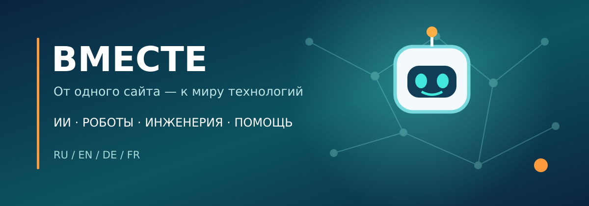

# «ВМЕСТЕ» — иллюстрированная книжная серия

**От одного сайта — к миру технологий.** История трёх месяцев разработки платформы взаимопомощи и проектов, которые неожиданно выросли из этой идеи: ИИ-помощников ВЕСТА и ТАШИ, инженерных моделей, полезных инструментов и идей робототехники.

## 📚 Читать книгу / Read the book / Buch lesen / Lire le livre

| Язык / Language | Книга / Book |
| --- | --- |
| 🇷🇺 Русский | [Читать](books/BOOK_RU.md) · [**PDF скачать**](downloads/VMESTE_Book_RU_2026.pdf) |
| 🇬🇧 English | [Read](books/BOOK_EN.md) · [**Download PDF**](downloads/VMESTE_Book_EN_2026.pdf) |
| 🇩🇪 Deutsch | [Lesen](books/BOOK_DE.md) · [**PDF herunterladen**](downloads/VMESTE_Book_DE_2026.pdf) |
| 🇫🇷 Français | [Lire](books/BOOK_FR.md) · [**Télécharger PDF**](downloads/VMESTE_Book_FR_2026.pdf) |

**Четыре PDF опубликованы и доступны для скачивания.** Они автоматически собраны из открытых текстов, с иллюстрированной обложкой. Более насыщенное графическое издание подготовлено отдельно; его изображения ещё не перенесены в этот репозиторий.

## 🌍 Присоединяйтесь / Follow VMESTE

- **Сайт / Website:** [вместе.site](https://xn--b1aga0a0ag.site/)
- **Telegram:** [@VmesteSiteBot](https://t.me/VmesteSiteBot)
- **ВКонтакте / VK:** [Вместе | Помощь рядом](https://vk.com/club243081835)
- **MAX:** [Открыть MAX](https://web.max.ru/772602012)

Ссылки на каналы не означают, что автоматическое создание заявок через каждого бота уже запущено.

## ❤️ Поддержать наши проекты / Support Our Projects

[**Поддержать проект «Вместе» на сайте**](https://xn--b1aga0a0ag.site/)

*Support our projects · Unsere Projekte unterstützen · Soutenir nos projets*

Ссылка ведёт прямо на сбор в Т‑Банке. Перед переводом проверьте получателя и условия банка.

## ✨ Следующие книги / Coming next

- **ВЕСТА и ТАШИ: ИИ-помощники в повседневной жизни**
- **От инженерных моделей к полезным роботам**
- **Мастерская будущего: от идеи до рабочего прототипа**

## О книге

Это история реальной разработки. Работающие компоненты, испытываемые прототипы и будущие идеи чётко разделены. Изображения роботов — художественные концепции, а не фотографии изготовленных устройств. Конкретные предприятия, партнёры, закрытые инженерные сведения и географические привязки не раскрываются.

**Программа «Вместе» и исходный код сайта хранятся отдельно.** Этот репозиторий содержит только материалы для читателей.
