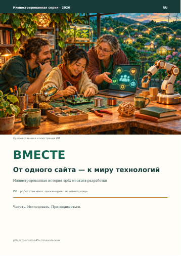
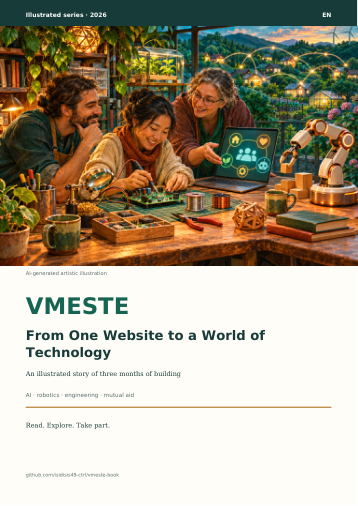
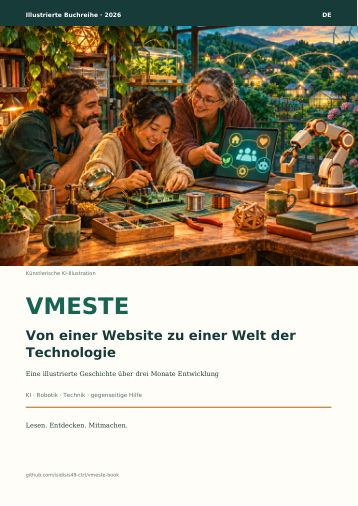

# VMESTE — от одного сайта к миру технологий

**Четыре иллюстрированные книги о людях, искусственном интеллекте и инженерных идеях.**

**Four illustrated editions about people, artificial intelligence and engineering ideas.**

## Читать и скачать · Read and download · Lesen und herunterladen · Lire et télécharger

| Русский | English | Deutsch | Français |
|:--:|:--:|:--:|:--:|
|  |  |  |  |
| **[Скачать PDF](https://github.com/isidisis49-ctrl/vmeste-book/raw/main/downloads/VMESTE_Book_RU_2026.pdf)** | **[Download PDF](https://github.com/isidisis49-ctrl/vmeste-book/raw/main/downloads/VMESTE_Book_EN_2026.pdf)** | **[PDF herunterladen](https://github.com/isidisis49-ctrl/vmeste-book/raw/main/downloads/VMESTE_Book_DE_2026.pdf)** | **[Télécharger le PDF](https://github.com/isidisis49-ctrl/vmeste-book/raw/main/downloads/VMESTE_Book_FR_2026.pdf)** |
| [Текст](books/BOOK_RU.md) | [Text](books/BOOK_EN.md) | [Text](books/BOOK_DE.md) | [Texte](books/BOOK_FR.md) |

**10 страниц в каждом PDF · 10 pages per edition · 10 Seiten pro Ausgabe · 10 pages par édition**

[Публичный выпуск / Public release](https://github.com/isidisis49-ctrl/vmeste-book/releases/tag/v2026.11.15-illustrated) · [SHA-256](downloads/SHA256SUMS) · [Проверка изданий / Edition checks](docs/PUBLISHING_REPORT.md)

### Русский

Сначала был сайт взаимопомощи. Затем появились ВЕСТА, ТАШИ, инженерные симуляторы и идея собственной технологической мастерской. Эта книга рассказывает о трёх месяцах разработки — с пятью полноцветными художественными сценами и настоящими экранами локальных программ.

Работающие компоненты, проверочные сборки и будущие идеи разделены. Роботы на иллюстрациях — концепции, а не изготовленные устройства. Справочный каталог не выдаётся за зарегистрированных исполнителей.

**[Читать русское издание](downloads/VMESTE_Book_RU_2026.pdf)** · **[Поддержать наши проекты](https://www.tbank-online.com/mybank/poolmoney/for/r_YlAHUiuafH.pMxtweDzlU/QV8J770476/)**

### English

A mutual-aid website grew into an unexpected exploration of local AI, useful software and engineering. This illustrated account follows three months of development, with five full-colour artistic scenes and actual screens from local programs.

Working components, review builds and future concepts are identified separately. The robots are artistic visions, not devices already built. Editorially translated screenshots do not imply a released multilingual product.

**[Read the English edition](downloads/VMESTE_Book_EN_2026.pdf)** · **[Support Our Projects](https://www.tbank-online.com/mybank/poolmoney/for/r_YlAHUiuafH.pMxtweDzlU/QV8J770476/)**

### Deutsch

Aus einer Plattform für gegenseitige Hilfe entstanden Ideen für lokale KI, praktische Programme und technische Modelle. Die illustrierte Geschichte begleitet drei Monate Entwicklung — mit fünf farbigen künstlerischen Szenen und echten Ansichten lokaler Programme.

Funktionsfähige Komponenten, Prüffassungen und Zukunftsideen werden klar unterschieden. Die Roboter sind künstlerische Konzepte. Redaktionell übersetzte Bildschirmansichten sind kein Nachweis einer veröffentlichten mehrsprachigen Produktversion.

**[Die deutsche Ausgabe lesen](downloads/VMESTE_Book_DE_2026.pdf)** · **[Unsere Projekte unterstützen](https://www.tbank-online.com/mybank/poolmoney/for/r_YlAHUiuafH.pMxtweDzlU/QV8J770476/)**

### Français

Un site d'entraide a ouvert un chemin inattendu vers l'IA locale, des logiciels utiles et des modèles techniques. Ce récit illustré retrace trois mois de développement, avec cinq scènes artistiques en couleur et de véritables captures de programmes locaux.

Les composants fonctionnels, les versions de vérification et les idées futures sont clairement distingués. Les robots sont des concepts artistiques. Les interfaces traduites pour le livre ne constituent pas une version multilingue publiée du produit.

**[Lire l'édition française](downloads/VMESTE_Book_FR_2026.pdf)** · **[Soutenir nos projets](https://www.tbank-online.com/mybank/poolmoney/for/r_YlAHUiuafH.pMxtweDzlU/QV8J770476/)**

## Проект · The project · Das Projekt · Le projet

- [Сайт / Website / Website / Site](https://xn--b1aga0a0ag.site/)
- [Telegram](https://t.me/VmesteSiteBot)
- [VK](https://vk.com/club243081835)
- [MAX](https://web.max.ru/772602012)
- [Книги и материалы / Books and sources](https://github.com/isidisis49-ctrl/vmeste-book)

Перед поддержкой проверьте получателя и условия банка. Check the recipient and the bank's terms before contributing. Vor einer Überweisung Empfänger und Bankbedingungen prüfen. Vérifiez le bénéficiaire et les conditions de la banque avant tout virement.

## Для тех, кто хочет поделиться

[Короткие объявления на четырёх языках](docs/SHARE.md) · [Обложки](assets/previews) · [Происхождение скриншотов](assets/screens/provenance.json) · [Сборка PDF](docs/BUILD.md)

Материалы можно читать и скачивать без регистрации на сайте проекта. Публикация книги не означает автоматического создания заявок через каждого бота. Программы и исходники рабочего сайта хранятся отдельно; здесь — читательские материалы и средства сборки книг.
