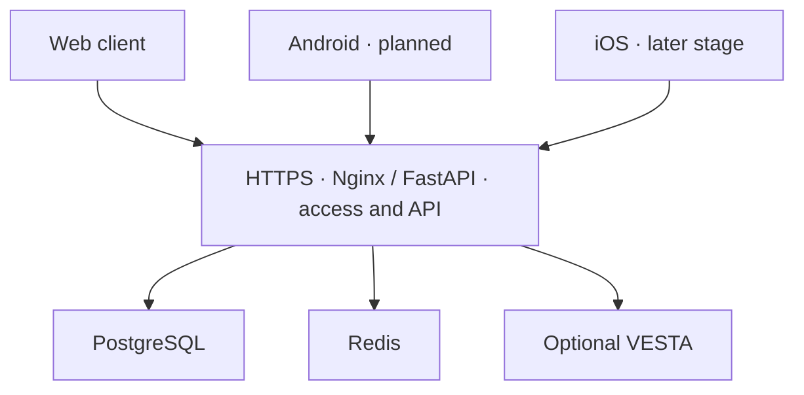
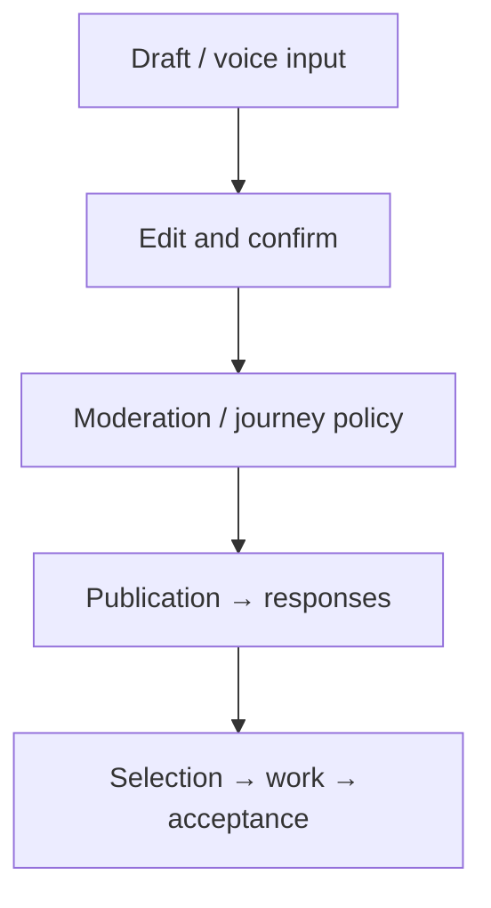
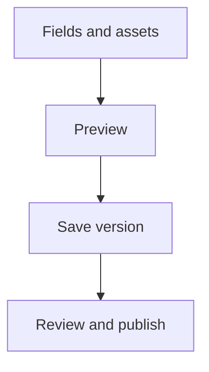
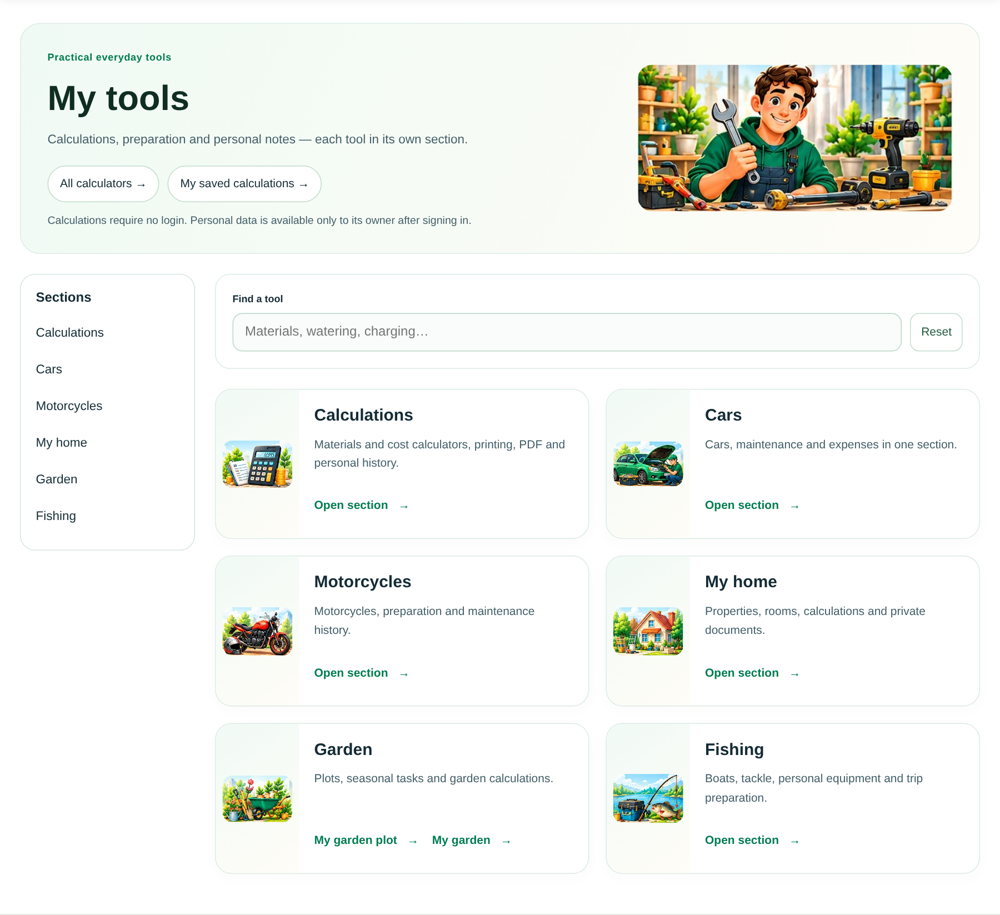
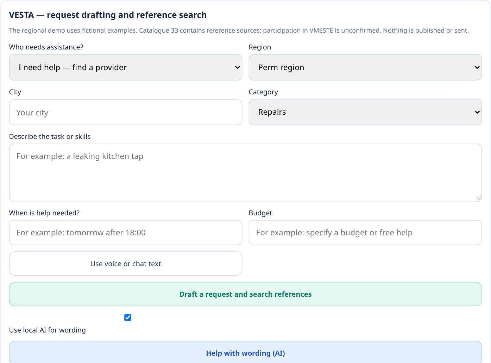
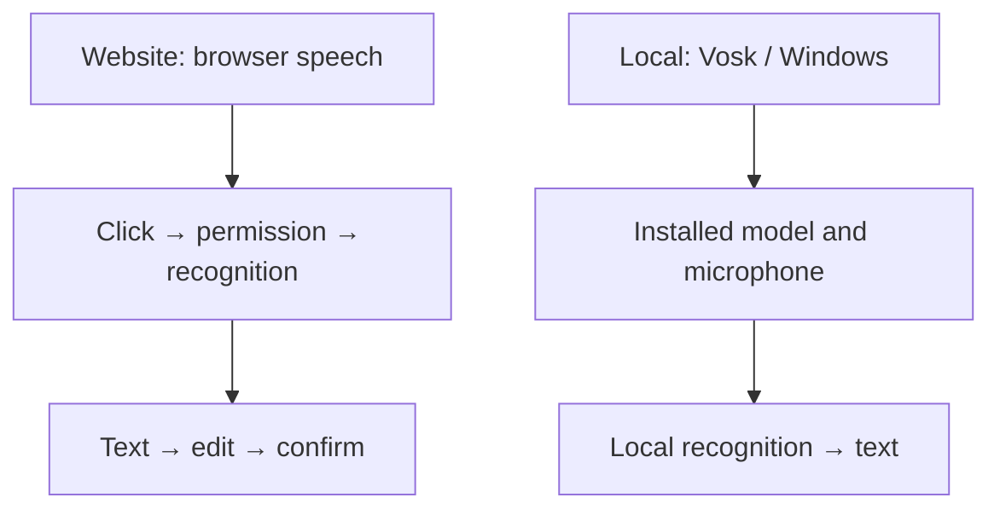
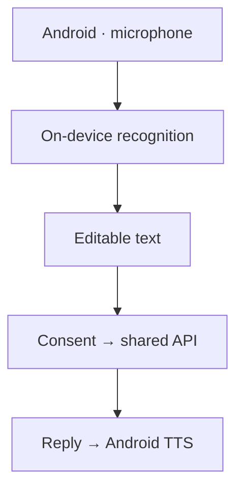
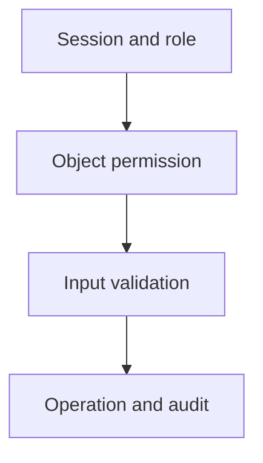
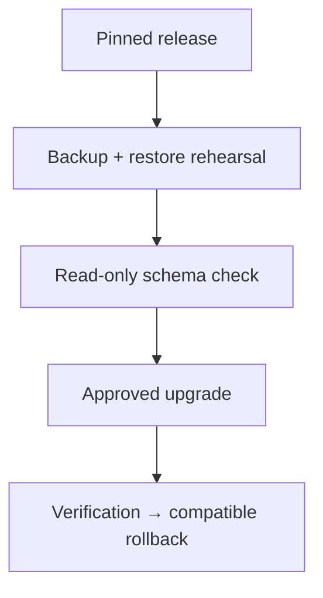

# VMESTE Website Technical Passport

*Functionally complete platform configuration*

**DESIGN EDITION · FOR APPROVAL**

Document: TP-VMESTE-2026.11 · revision 1.0

Prepared: 15 November 2026

System: https://xn--b1aga0a0ag.site/

Document language: English

This passport describes the complete system proposed for approval: the website, accounts, requests, communication, reference search, tools and VESTA. It presents a unified operating model. It does not establish that every component has been deployed, accepted or tested on the live server. A separate Android application is included as the priority for design and later development. An iOS application is a distinct subsequent stage. This document does not claim completed mobile builds.

AI illustrations express the project concept; they are not photographs of installed equipment. This document is not a commissioning certificate, compliance certification or availability guarantee.

## 1. Purpose and system scope

VMESTE connects customers, providers and administrators in one digital environment. A user describes a task, finds offers, communicates and confirms the outcome. AI helps prepare information; it does not replace the parties or their consent.

Scope: responsive web interface; application API; database; user accounts; service requests and journeys; responses, private chat and notifications; maps; articles; tools; administration; and optional VESTA integration. The local VESTA and TASHI applications are separate products, not mandatory server components.

| Area | Purpose | Evidence / status |
| --- | --- | --- |
| Users and requests | Registration, profiles, responses, chat | Baseline modules present in website source |
| Content and builders | Articles, banners, forms and tools | Actual source components; release acceptance is separate |
| VESTA and catalogue | Drafts, matching, supervision | Laboratory development; deployment unconfirmed |
| Messengers | VK and MAX contact channels | Operation previously confirmed by owner; not retested today |
| Local voice and AI | Vosk, Ollama, Windows voice | Depend on a separate local build and components |
| Android / iOS | Separate clients of the shared API | Android is the development priority; iOS is a later stage |

> Implementation status and production readiness are different properties. Four publication languages do not mean that the website or speech recognition already supports four languages.

## 2. Architecture and software components

The React/TypeScript web client accesses FastAPI through an HTTPS Nginx reverse proxy. PostgreSQL stores application data. Redis supports the service operations defined in the code. Uploads use the configured filesystem or compatible object storage.

Containers separate components. VESTA uses restricted website interfaces; a separate service is a target deployment option, not confirmation of a running container. Any industrial assistant is a separate deployment and must not obtain enterprise data through the public website.

| Component | Technology / purpose |
| --- | --- |
| Client | React, TypeScript, browser interface |
| Application | Python 3.12, FastAPI, Uvicorn |
| Data | PostgreSQL 16, SQLAlchemy, Alembic |
| Infrastructure | Docker Compose, Nginx, Redis |
| Geographic services | OSM map; configured geocoding and routing services |



> Dependency versions are not permanent requirements: each approved release pins its exact composition in a manifest.

## 3. Request lifecycle

Draft → author review → submission → moderation → public request → provider responses → helper selection → work → outcome confirmation. Rejection and cancellation are separate outcomes. The server checks valid transitions and participant permissions.

An ordinary unapproved request must be inaccessible to outsiders through listings, direct identifiers and new VESTA APIs alike. Authentication and ownership checks run on the backend. This scenario is a blocking acceptance criterion.

Journeys have a separate publication policy. In the inspected source version, automatic approval is tied to the journey category rather than a separate urgency check. The final policy requires agreement and verification before release.

FREE in the inspected code provides 5 responses with no calendar expiry and no automatic reset. It does not mean unlimited responses or five concurrently open requests. Paid-access duration is distinct from request lifetime; completing work does not itself restore the free quota.



> Subscription expiry must not silently change an already agreed job. Access to existing conversations and completion actions requires separate tests.

## 4. Builders and practical tools

The administrative banner builder provides layout settings, background and logo assets, preview, project saving, image export and publication to an available placement. Project versions and idempotency keys protect against conflicts and retries. This describes the actual BannerConstructor component, not a newly promised editor.

The article and document editor belongs to the existing administration interface. The request builder is a structured form with category, description, location and other fields. VESTA prepares wording; the user edits and submits it.

The tools catalogue groups existing calculation, home, transport, garden and other sections. A category does not establish equal readiness of every tool. The heating simulator displays calculated values, not actual sensor readings.





Actual tools-catalogue interface from a local review build. This is not the banner-builder screen and does not prove deployment of this version to the live website.

> A general visual builder for arbitrary website pages is not established by the inspected materials and is not listed as a completed capability.

## 5. VESTA and provider search

Target flow: problem description → editable request draft → identification of service and locality → recommendations. Ordinary deterministic search does not require a large language model. Ollama is a separate dependency for local AI features, not a prerequisite for website availability.

The reference catalogue contains 81 source listings: 56 draft and 25 hold. Identifiers, statuses and sources are preserved. Repeated imports must not create duplicates or turn listings into user accounts. The source catalogue contains no confirmed registered providers.

Hold records are excluded from recommendations. The service and locality must match verified data. Cross-locality recommendations require confirmed travel conditions; none are confirmed in the reviewed dataset. An empty result is valid and must not be replaced with an invented recommendation.

Required warning: “Reference listing. Participation in VMESTE and availability are unconfirmed.” Linking a listing to a real account requires registration and independent authority verification; it does not automatically verify qualifications, price or availability.



Actual local VESTA interface from a review build. The capture does not establish a real microphone or model test, or deployment to the VDS.

## 6. Voice capabilities

Website speech input uses SpeechRecognition/webkitSpeechRecognition where supported by the browser. It requires microphone permission and a secure HTTPS context or a permitted local context. The user explicitly starts capture; recognised text remains visible and editable before a consequential action.

Browser recognition may use a vendor service and is not guaranteed offline. The inspected implementation sets session language to ru-RU. Text input remains available if the microphone, browser support or network is unavailable.

Website voice output uses SpeechSynthesis. The inspected implementation selects local Microsoft Pavel; without the required voice, the answer stays textual. This is not a promise of speech output on every device. Output can be disabled and stopped.

Local VESTA may use Vosk with an installed compatible model for offline recognition. Windows SAPI depends on the local build and installed voices. Vosk recognition does not require Ollama, but a module alone does not replace physical microphone testing. This passport does not install a heavy voice model on the VDS.



> Voice is not proof of identity and does not bypass authorisation. A spoken command does not automatically authorise publication, sanctions, file deletion or payment.

## 6.1. Independent Android and iOS systems

Android is the priority standalone application, not a wrapped webpage. Proposed stack: Kotlin and Jetpack Compose; the website’s shared authorised API; dedicated login, profile, request creation, search and communication screens. Users and requests remain in one system, without a second independent real-account database.

Android voice: explicit tap and RECORD_AUDIO permission → SpeechRecognizer → editable text → action confirmation. Output uses Android TextToSpeech with checks for language and installed engine, not Microsoft Pavel or Windows SAPI. The minimum Android version follows the target-device set.

Offline recognition first checks on-device API and language availability. EXTRA_PREFER_OFFLINE alone is not an offline guarantee. Vosk may become an optional embedded module after model and resource testing; multi-gigabyte downloads require consent.

iOS is a separate planned application: Swift/SwiftUI, Speech and AVSpeechSynthesizer. Offline support depends on language and device. Service secrets are not embedded in applications; saving local drafts offline is not request publication. APK/AAB, iOS builds, signing and device tests have not been prepared.

| System | Voice and API | Status |
| --- | --- | --- |
| Android | SpeechRecognizer / TextToSpeech; shared API | Required development priority |
| iOS | Speech / AVSpeechSynthesizer; shared API | Separate subsequent stage |
| Mobile browser | Web Speech API | Additional channel, not a substitute application |



> Android acceptance covers a real microphone, denied permission, Russian speech, background/return, missing service, connection loss, token protection, API compatibility and manual confirmation. No Android/iOS device testing was performed here. If a local speech engine is unavailable, offer text input; network recognition requires separate, understandable consent.

## 7. Administration and VESTA moderation

VESTA Control belongs to the existing administration interface. Mode 1 is observation and a signal log. Mode 2 adds recommendations, evidence and proposed measures. Mode 3 prepares an action that an authorised administrator applies only after explicit confirmation. Observation is the default.

A higher mode does not expand data access. VESTA receives no general administrative token. A warning, temporary restriction and permanent ban are separate sanction types, not the three operating modes.

A decision records its actor, time, basis and outcome. Reversal and appeals are provided for. Application rollback must not disable existing restrictions. A cryptographic audit chain improves detection of changes but is not complete protection against a database administrator without an external checkpoint.

| Role | Authorised responsibility |
| --- | --- |
| Operator | Review signals and refer cases |
| Moderator | Examine evidence and propose decisions |
| Administrator | Approve/revoke measures, manage rules and mode |
| VESTA | Analyse permitted information and prepare proposals |

> Autonomous AI blocking of a user is prohibited in every mode.

## 8. Data, privacy and security

Core entities include user, profile, request, response, helper selection, chat, message, notification, content, quota and audit record. New VESTA entities link to existing users; no separate database of fictitious providers is created.

Controls include HTTPS, server-side session and role checks, object ownership checks, least-privilege runtime access, input validation, request limits, idempotency for significant operations and protection of unpublished records. Numerical limits belong to configuration and individual API contracts.

Secrets, passwords, JWTs, raw conversations and private dumps are excluded from this public passport and error reports. Sensitive VESTA fields in the laboratory implementation are encrypted; keys are held separately and included in the private recovery plan. This does not imply whole-database disk encryption.

Retention, deletion, backup and evidence access follow an approved policy. Legal and personal-data compliance require separate assessment; this document does not certify them.



> Third-party text, documents and messages are not administrative commands. Retrieved information must not increase assistant privileges.

## 9. Operations, upgrades and rollback

A release pins a source commit, file manifest, dependencies, images and checksums. Startup verifies schema compatibility through metadata reads without DDL, DML, seeding or automatic repair. The application startup command contains no hidden alembic upgrade head.

The last owner-supplied live schema is 0035_editorial. The inspected VESTA 30 candidate requires 0036_vesta29. A mismatch stops startup. Schema changes require separate approval, a current backup and rehearsal against an isolated restored database.

Backups include PostgreSQL, uploads/object files, configuration, private keys, bot data and current images. Integrity, restoration and an off-server copy must be verified. Older working backups are retained until the replacement has been checked.

Upgrades follow an approved plan. Checks cover the homepage, API, login, requests, chat, Redis, PostgreSQL, Nginx and bots. A serious regression triggers return to a compatible application version. Database rollback is not automatic: it must not lose new records or cancel sanctions.



> Preparing this passport does not modify the VDS, containers, live databases or the owner’s local installation.

## 10. Resources, integrations and verification

CPU, RAM, storage and user-capacity requirements follow measurements of an agreed build under representative load. This passport makes no unverified throughput or availability promises. A large AI model and Vosk are not mandatory dependencies of the lightweight server mode.

Maps, addresses and routes depend on the chosen OSM/Nominatim/OSRM services, connectivity and their usage policies. An unavailable geoservice should produce a clear error rather than an invented address. Writing this passport does not establish that the historical 502 problem has been fixed.

VK and MAX are existing contact channels whose operation the owner previously confirmed. The complete bot → VESTA → request flow needs its own end-to-end test. A public Telegram link is not proof of an installed integration.

Historical owner-PC results for AutoTest Catalog33 Fix3: 158 pytest PASS and 7 SKIP; including two environment checks, 160 PASS, 0 FAIL and 7 SKIP. SKIP means untested. These results concern a specific test package, not acceptance of the current VDS, its load capacity, a real microphone or external services.

Illustrative monthly operating inputs without a heavy model: server USD 30–120, backup storage USD 10–50, mail/domains/services USD 5–60; total USD 45–230 before support. These are budget assumptions, not verified vendor quotes or the owner’s current bill. Support and GPU costs are separate.

| Before commissioning | Required evidence |
| --- | --- |
| Request and role security | Negative API and direct-access tests |
| Core actions | Browser scenarios and actual navigation |
| Voice and messaging | Physical-device tests and actual message exchange |
| Data and rollback | Backup restoration and compatibility |
| Capacity | Measurements in the approved environment |

## 11. Indicative cost in foreign currency

This estimate concerns recreating the functionally complete social platform from scratch. It is not the website’s current market value, historical spending or evidence that every function is ready. Method: preliminary effort of 1,100–2,000 hours × an assumed development rate of USD 30–60 per hour.

Total: USD 33,000–120,000 before taxes and a separate contingency. At a purely illustrative conversion of EUR 1 = USD 1.10, this is approximately EUR 30,000–109,000. This is not a market exchange-rate quotation for the document date. A commercial offer must set its own conversion basis.

Excluded: training a proprietary large model, GPU infrastructure, industrial integration, hardware purchasing, large-scale provider verification, legal review, paid external APIs and marketing. Existing source code may reduce future effort; the price of further development needs a separate audit.

Separate Android MVP budget: 400–800 hours × USD 30–60 = USD 12,000–48,000. Website plus Android: USD 45,000–168,000. A later iOS stage adds 360–720 hours = USD 10,800–43,200. The shared API is reused; mobile budgets are not included in the website table. These are planning assumptions, not completed work or a contractor quotation.

| Work package | Hours | USD: low–high estimate |
| --- | --- | --- |
| Discovery / architecture | 80–160 | 2,400–9,600 |
| Web interface | 160–320 | 4,800–19,200 |
| Backend / data / security | 240–440 | 7,200–26,400 |
| Requests / communication / maps | 180–320 | 5,400–19,200 |
| Administration / builders / content | 160–280 | 4,800–16,800 |
| VESTA / catalogue / voice integration | 140–260 | 4,200–15,600 |
| QA / release / backup / documentation | 140–220 | 4,200–13,200 |
| TOTAL | 1,100–2,000 | 33,000–120,000 |

## 12. Deliverables and integrity

The passport package contains Russian and English PDF and Markdown editions, build source, illustrations/diagrams, a source register and document-validation results. PDFs have searchable text and active links. Block diagrams are editorial architecture diagrams, not captures of running infrastructure.

The three approved homepage illustrations are retained. The checksums below were previously supplied by the owner. Preparing this passport did not include a fresh VDS file check.

```text
help-together-480.webp
SHA-256: 0066708e2509faa2ebf6e0e5ef0d97630eb1697093fdc4f2475659feb7b08118
help-together-960.webp
SHA-256: 10e519b7cf9d8bca60ba3a5fff37a46ddacae4b370d37ea738dd1e240706d397
help-together-1448.webp
SHA-256: 91681e5ff52d92a52a3b6df36850ddfd6cfa7fe5cd1de53ae612b4ee2cc6bfb8
```

> Commissioning approval, responsible-party signature and acceptance date may be completed only after actual agreement. This edition does not claim acceptance.

## Project links

- [Website](https://xn--b1aga0a0ag.site/)
- [Platform source](https://github.com/isidisis49-ctrl/111)
- [Books](https://github.com/isidisis49-ctrl/vmeste-book)
- [VK](https://vk.com/club243081835)
- [MAX](https://web.max.ru/772602012)

- https://developer.mozilla.org/en-US/docs/Web/API/SpeechRecognition
- https://webkit.org/blog/11648/new-webkit-features-in-safari-14-1/
- https://developer.android.com/reference/android/speech/SpeechRecognizer
- https://developer.android.com/reference/android/speech/RecognizerIntent
- https://developer.apple.com/documentation/Speech/SFSpeechRecognizer/supportsOnDeviceRecognition
