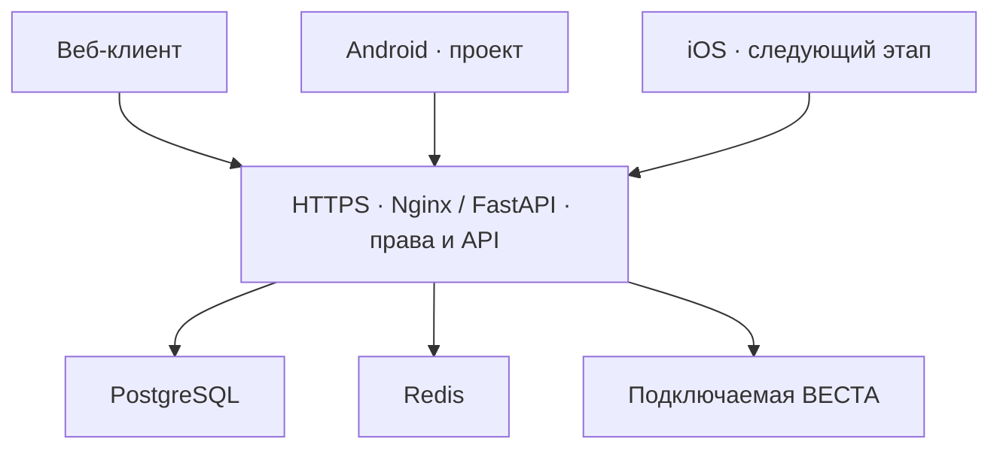
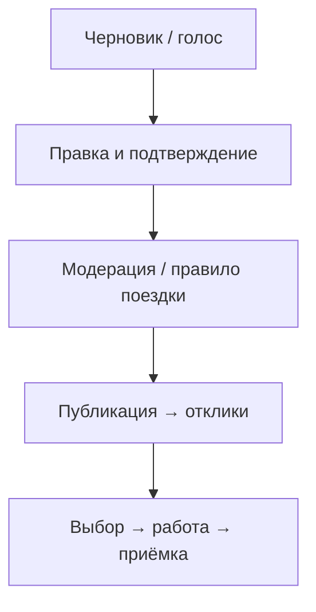
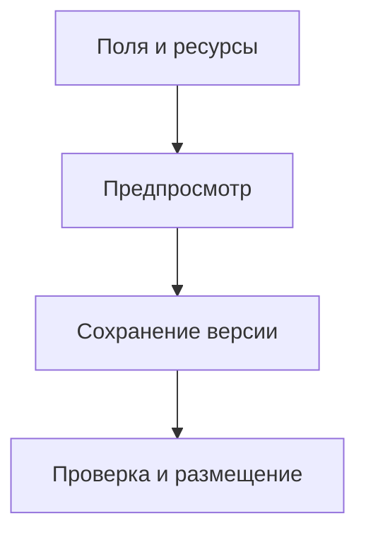
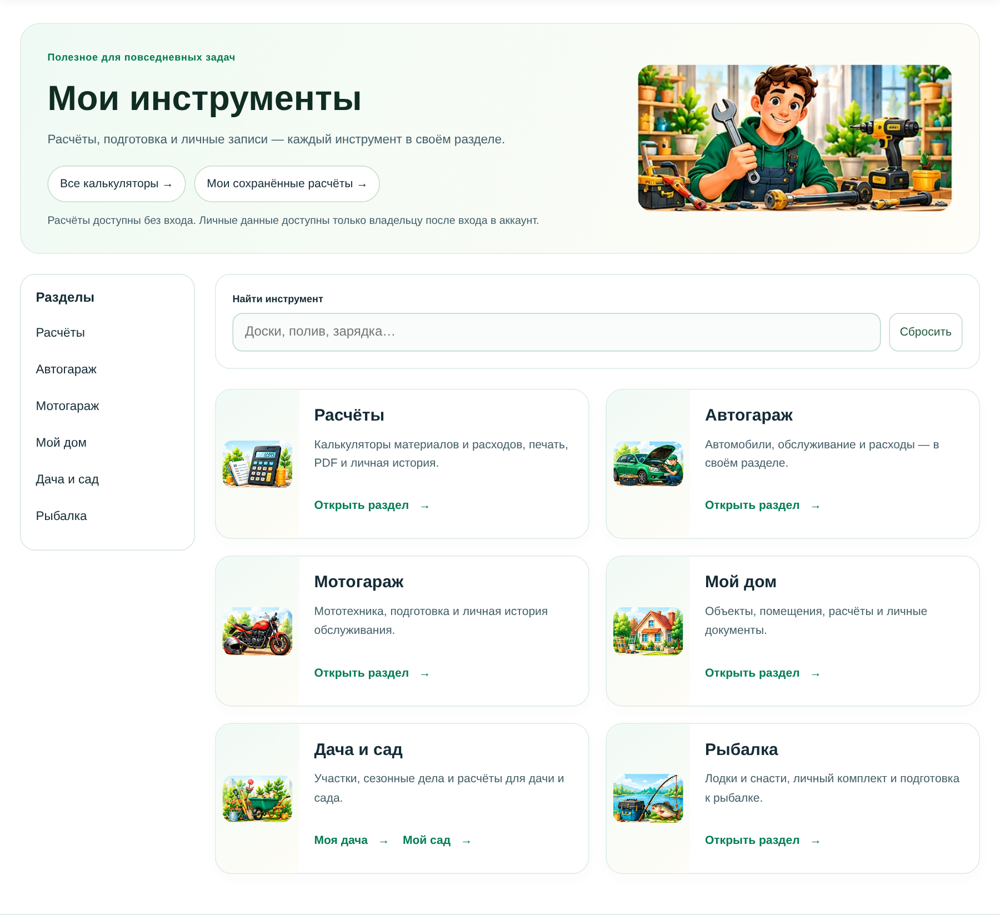
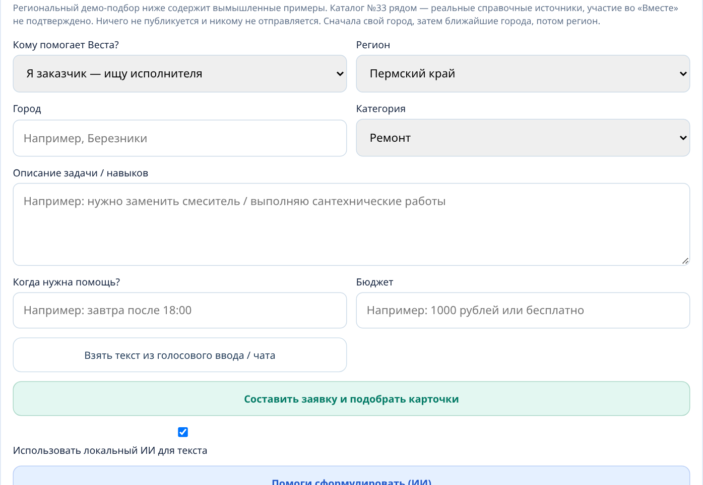
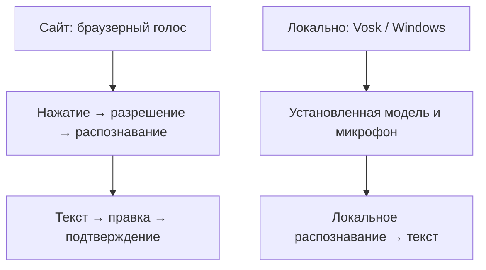
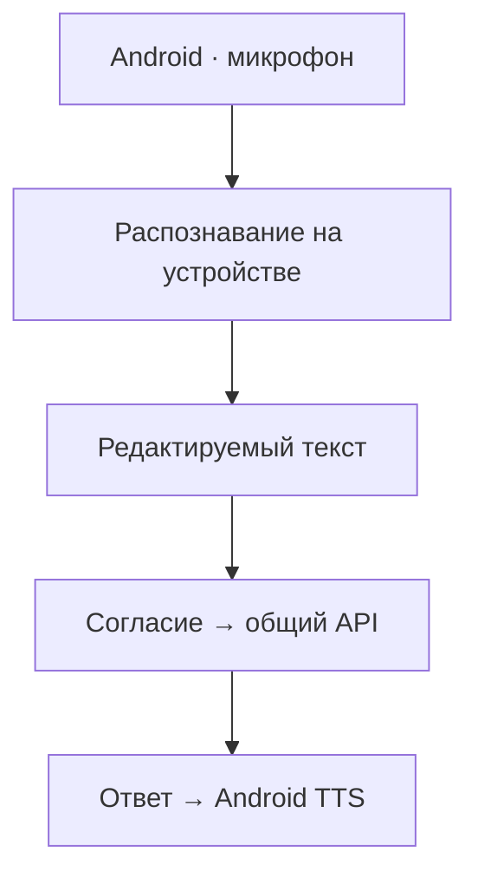
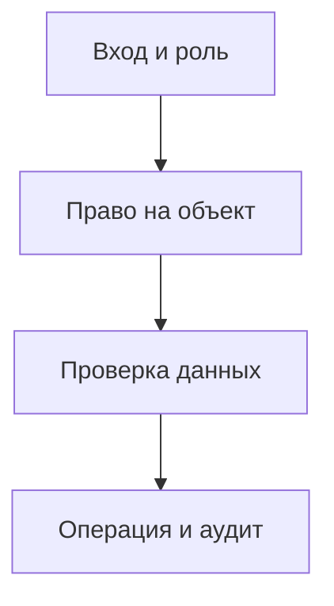
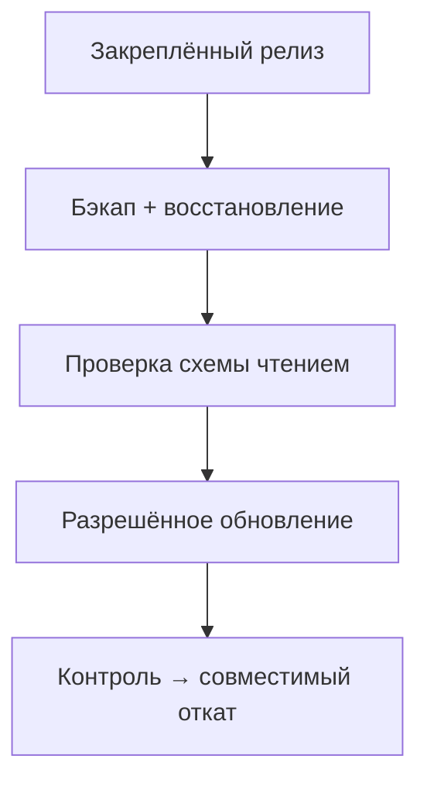

# Технический паспорт сайта «Вместе»

*Функционально полная конфигурация платформы*

**ПРОЕКТНАЯ РЕДАКЦИЯ · ДЛЯ СОГЛАСОВАНИЯ**

Документ: TP-VMESTE-2026.11 · редакция 1.0

Дата подготовки: 15 ноября 2026 года

Объект: https://xn--b1aga0a0ag.site/

Язык документа: русский

Паспорт описывает согласуемую полную систему: сайт, личные кабинеты, заявки, связь, справочный поиск, инструменты и ВЕСТУ. Описание дано как единая эксплуатационная модель. Оно не означает, что все перечисленные компоненты уже установлены, приняты или испытаны на рабочем сервере. Отдельное Android-приложение включено как приоритет проектирования и последующей разработки. Приложение iOS — самостоятельный следующий этап. Готовые мобильные сборки этим документом не заявляются.

Иллюстрации ИИ обозначают идею проекта; они не являются фотографиями установленного оборудования. Документ не является актом ввода в эксплуатацию, сертификатом соответствия или гарантией доступности.

## 1. Назначение и состав системы

«Вместе» соединяет заказчика, исполнителя и администратора в одном цифровом пространстве. Пользователь формулирует задачу, находит предложения, общается и подтверждает результат. ИИ помогает готовить сведения, но не заменяет участников сделки и их согласие.

Состав: адаптивный веб-интерфейс; API приложения; база данных; личные кабинеты; заявки и поездки; отклики, приватный чат и уведомления; карты; статьи; инструменты; административная панель; подключаемая ВЕСТА. Локальные приложения ВЕСТА и ТАШИ — отдельные продукты, не часть обязательного серверного контура.

| Область | Назначение | Основание / статус |
| --- | --- | --- |
| Пользователи и заявки | Регистрация, профиль, отклики, чат | Базовые модули в исходниках сайта |
| Контент и конструкторы | Статьи, баннеры, формы и инструменты | Реальные компоненты в исходниках; приёмка сборки отдельно |
| ВЕСТА и каталог | Черновики, подбор, контроль | Лабораторные разработки; установка не подтверждена |
| Мессенджеры | VK и MAX как точки связи | Работа ранее подтверждена владельцем; сегодня не проверялась |
| Локальный голос и ИИ | Vosk, Ollama, Windows-голос | Зависят от отдельной локальной сборки и компонентов |
| Android / iOS | Отдельные клиенты общего API | Android — приоритет разработки; iOS — следующий этап |

> Статус реализации и готовность к production — разные свойства. Четыре языка изданий не означают, что сайт или распознавание речи уже поддерживают четыре языка.

## 2. Архитектура и программные компоненты

Веб-клиент React/TypeScript обращается к FastAPI через HTTPS reverse proxy Nginx. Прикладные данные сохраняются в PostgreSQL. Redis участвует в предусмотренных кодом сервисных операциях. Загрузки размещаются в настроенном файловом или совместимом объектном хранилище.

Контейнеризация отделяет компоненты. ВЕСТА использует ограниченные интерфейсы сайта; размещение её в отдельном сервисе — целевой вариант, а не подтверждение запущенного контейнера. Промышленный помощник, если создаётся, размещается отдельно и не получает данные через общественный сайт.

| Компонент | Технология / назначение |
| --- | --- |
| Клиент | React, TypeScript, браузерный интерфейс |
| Приложение | Python 3.12, FastAPI, Uvicorn |
| Данные | PostgreSQL 16, SQLAlchemy, Alembic |
| Инфраструктура | Docker Compose, Nginx, Redis |
| Геосервисы | OSM-карта; геопоиск и маршруты через настроенные сервисы |



> Версии зависимостей не являются фиксированным требованием навсегда: точный состав закрепляется манифестом каждого согласованного релиза.

## 3. Жизненный цикл заявки

Черновик → проверка автором → отправка → модерация → публичная заявка → отклики → выбор помощника → выполнение → подтверждение результата. Отклонение и отмена сохраняются как отдельные исходы. Сервер проверяет допустимость перехода и права участника.

Обычная неодобренная заявка не должна быть доступна посторонним ни в списке, ни по прямому идентификатору, ни через новый API ВЕСТЫ. Авторизация и проверка принадлежности выполняются на backend. Этот сценарий является блокирующим критерием приёмки.

Для поездок действует отдельная политика публикации. В просмотренной версии исходников автоматическое одобрение связано с категорией «Поездка», а не с отдельной проверкой срочности. Окончательное правило необходимо согласовать и проверить перед выпуском.

FREE в просмотренном коде даёт 5 откликов без календарного срока и без автоматического обновления. Это не обещание бесконечных откликов и не лимит пяти одновременно открытых заявок. Срок платного доступа не равен сроку жизни заявки; завершение работы само по себе не восстанавливает бесплатную квоту.



> Окончание подписки не должно самопроизвольно менять состояние уже согласованной работы. Правила доступа к активной переписке и завершению проверяются отдельными тестами.

## 4. Конструкторы и прикладные инструменты

Конструктор баннеров в административном интерфейсе: параметры макета, фон и логотип, предпросмотр, сохранение проекта, выгрузка изображения и размещение в доступном слоте. Версия проекта и идемпотентный ключ используются для защиты от конфликтов и повторов. Это описание реального компонента BannerConstructor, а не нового обещанного редактора.

Редактор статей и документов работает в существующей админке. Конструктор заявки — структурированная форма с категорией, описанием, местом и другими полями. ВЕСТА подготавливает текст, а пользователь редактирует и отправляет его сам.

Каталог инструментов объединяет существующие разделы расчётов, дома, транспорта, сада и других задач. Наличие категории не означает одинаковую готовность всех инструментов. Симулятор отопления показывает расчётные значения, не реальные показания датчиков.





Реальный интерфейс каталога инструментов из локальной проверочной сборки. Это не снимок конструктора баннеров и не доказательство установки данной версии на рабочем сайте.

> Общий визуальный редактор произвольных страниц сайта в просмотренных материалах не подтверждён; он не включён как готовая функция.

## 5. ВЕСТА и поиск исполнителей

Целевой путь: описание проблемы → редактируемый проект заявки → определение услуги и населённого пункта → рекомендации. Обычный детерминированный поиск работает без обязательной большой языковой модели. Ollama — отдельная зависимость для локальных ИИ-возможностей, а не условие доступности всего сайта.

Справочный каталог содержит 81 исходную карточку: 56 draft и 25 hold. Идентификаторы, статусы и источники сохраняются. Повторный импорт не должен создавать дубли или превращать карточки в аккаунты пользователей. В исходном каталоге нет подтверждённых зарегистрированных исполнителей.

Записи hold исключаются из рекомендаций. Услуга и населённый пункт должны соответствовать подтверждённым данным. Межгород разрешается только при подтверждённых условиях выезда; в рассмотренном наборе таких условий нет. Пустой результат допустим и не заменяется выдуманной рекомендацией.

Обязательная подпись: «Справочная карточка. Участие во „Вместе“ и доступность не подтверждены». Связь карточки с реальным аккаунтом требует регистрации и независимой проверки полномочий; она не подтверждает автоматически квалификацию, цену и свободное время.



Реальный локальный интерфейс ВЕСТЫ из проверочной сборки. Снимок не подтверждает работу настоящего микрофона, модели или установку на VDS.

## 6. Голосовые возможности

На сайте голосовой ввод использует SpeechRecognition/webkitSpeechRecognition при поддержке браузером. Нужны разрешение микрофона и безопасный контекст HTTPS либо допустимый локальный контекст. Запуск — по явному действию пользователя; распознанный текст остаётся видимым и редактируемым до значимого действия.

Браузерное распознавание может обращаться к сервису поставщика и не считается гарантированно автономным. В просмотренном коде язык сессии ru-RU. При отказе микрофона, отсутствии поддержки или сети сохраняется текстовый ввод.

Голосовой ответ сайта использует SpeechSynthesis. В просмотренной реализации выбирается локальный Microsoft Pavel; если нужного голоса нет, ответ остаётся текстовым. Это не универсальная гарантия озвучивания на каждом устройстве. Предусмотрены отключение и остановка воспроизведения.

Локальная ВЕСТА может использовать Vosk с установленной совместимой моделью без интернета. Windows SAPI зависит от локальной сборки и установленных голосов. Распознавание Vosk не требует Ollama, но наличие модуля не заменяет испытание микрофона на реальном ПК. На VDS тяжёлая голосовая модель в рамках паспорта не устанавливается.



> Голос не подтверждает личность и не обходит авторизацию. Произнесённая команда не разрешает автоматически публикацию, санкцию, удаление файла или платёж.

## 6.1. Самостоятельные Android- и iOS-системы

Android — приоритетное отдельное приложение, а не оболочка страницы. Проектный стек: Kotlin и Jetpack Compose; общий авторизованный API сайта; собственные экраны входа, профиля, создания заявки, поиска и общения. Пользователи и заявки остаются в общей системе, без второй независимой базы реальных аккаунтов.

Голос Android: явное нажатие и разрешение RECORD_AUDIO → SpeechRecognizer → редактирование текста → подтверждение действия. Озвучивание — Android TextToSpeech с проверкой языка и установленного движка, а не Microsoft Pavel/Windows SAPI. Минимальную версию Android выбирают по целевым устройствам.

Для автономного распознавания сначала проверяют доступность on-device API и языка. EXTRA_PREFER_OFFLINE сам по себе не гарантирует работу без сети. Vosk может стать дополнительным встроенным модулем после испытания модели и ресурсов; многогигабайтные загрузки не выполняются без согласия.

iOS — отдельное планируемое приложение: Swift/SwiftUI, Speech и AVSpeechSynthesizer. Автономный режим зависит от поддерживаемого языка и устройства. Секреты сервиса не встраиваются в приложения; записи только локальных черновиков без сети не означают публикацию заявки. APK/AAB, iOS-сборка, подпись и испытания пока не подготовлены.

| Система | Голос и API | Состояние |
| --- | --- | --- |
| Android | SpeechRecognizer / TextToSpeech; общий API | Обязательный приоритет разработки |
| iOS | Speech / AVSpeechSynthesizer; общий API | Самостоятельный следующий этап |
| Мобильный браузер | Web Speech API | Дополнительный канал, не замена приложению |



> Приёмка Android: реальный микрофон, отказ разрешений, русский язык, фон/возврат, отсутствие сервиса, потеря сети, защита токена, совместимость API и ручное подтверждение. На Android/iOS в этой работе испытания не выполнялись. Если локальный речевой движок недоступен, показывается текстовый ввод; сетевой режим распознавания требует отдельного понятного согласия.

## 7. Администрирование и модерация ВЕСТЫ

Раздел «Контроль ВЕСТА» входит в существующую админку. Режим 1 — наблюдение и журнал сигналов. Режим 2 — рекомендации, доказательства и проект меры. Режим 3 — подготовка действия, которое применяет уполномоченный администратор после явного подтверждения. По умолчанию — наблюдение.

Повышение режима не расширяет доступ к данным. ВЕСТА не получает общий административный токен. Предупреждение, временное ограничение и постоянный бан — отдельная классификация санкций, не три режима работы.

Решение записывает автора, время, основание и результат. Предусматриваются отмена и обжалование. Откат приложения не должен отключать уже действующие ограничения. Криптографическая цепочка аудита повышает обнаруживаемость изменений, но не является полной защитой от администратора БД без внешней контрольной точки.

| Роль | Разрешённая ответственность |
| --- | --- |
| Оператор | Просмотр сигналов, передача случая |
| Модератор | Проверка доказательств и предложение решения |
| Администратор | Утверждение мер, отмена, правила и режим |
| ВЕСТА | Анализ разрешённых данных и подготовка предложений |

> Самостоятельная блокировка пользователя ИИ запрещена при любом режиме.

## 8. Данные, приватность и безопасность

Основные сущности: пользователь, профиль, заявка, отклик, выбор помощника, чат, сообщение, уведомление, контент, квота и аудит. Новые сущности ВЕСТЫ связываются с существующими пользователями; отдельная база фиктивных исполнителей не создаётся.

Контроли: HTTPS, серверные проверки сессии и ролей, проверка владельца объекта, минимальные права runtime-роли, валидация входа, ограничения запросов, идемпотентность значимых операций и защита от утечки неопубликованных записей. Численные лимиты задаются конфигурацией и контрактом конкретного API.

Секреты, пароли, JWT, исходные переписки и приватные дампы не входят в открытый паспорт или журнал ошибок. Чувствительные поля ВЕСТЫ в лабораторной реализации защищены шифрованием; ключи хранятся отдельно и включаются в приватный план восстановления. Это не означает шифрование всей БД на уровне диска.

Сроки хранения, удаление, резервирование и доступ к доказательствам определяются утверждённой политикой. Юридическое соответствие и защита персональных данных требуют отдельной проверки; этот документ их не сертифицирует.



> Сторонний текст, документ или сообщение не является административной командой. Извлечённая информация не должна расширять права помощника.

## 9. Эксплуатация, обновление и откат

Релиз закрепляет исходный commit, манифест файлов, версии зависимостей, образы и контрольные суммы. Перед запуском проверяется совместимость схемы чтением метаданных без DDL, DML, seed или автоматического repair. Команда запуска приложения не содержит скрытого alembic upgrade head.

Последняя переданная владельцем схема рабочего сайта — 0035_editorial. Рассмотренный кандидат ВЕСТЫ №30 требует 0036_vesta29. Несовместимость останавливает запуск. Новая схема применяется только после отдельного согласования, актуального бэкапа и репетиции на восстановленной изолированной БД.

Резервная копия включает PostgreSQL, загрузки/объектные файлы, конфигурацию, приватные ключи, данные ботов и текущие образы. Проверяются целостность, восстановление и копия вне VDS. Старые рабочие копии не удаляют до проверки новой.

Обновление выполняется по согласованному плану. Контролируются главная страница, API, вход, заявки, чат, Redis, PostgreSQL, Nginx и боты. При серьёзной регрессии возвращается совместимая программная версия. Откат БД не выполняется автоматически: он не должен терять новые данные или отменять санкции.



> Подготовка паспорта не изменяет VDS, контейнеры, рабочие базы или локальную установку владельца.

## 10. Ресурсы, интеграции и проверки

Требования к CPU, RAM, диску и числу пользователей определяются измерением согласованной сборки под реальной нагрузкой. В паспорт не включены неподтверждённые обещания производительности или доступности. Большая модель ИИ и Vosk не являются обязательными зависимостями лёгкого серверного режима.

Карты, адреса и маршруты зависят от выбранных OSM/Nominatim/OSRM-сервисов, сети и их правил использования. Недоступность внешнего геосервиса должна давать понятную ошибку, а не выдуманный адрес. Историческая ошибка 502 не считается устранённой только по факту составления паспорта.

VK и MAX — существующие точки связи, работа которых ранее подтверждена владельцем. Общая цепочка «бот → ВЕСТА → заявка» требует самостоятельного сквозного испытания. Публичная ссылка Telegram не доказывает установленную интеграцию.

Исторический Windows-прогон Автотеста Catalog33 Fix3: 158 pytest PASS, 7 SKIP; с двумя проверками окружения — 160 PASS, 0 FAIL, 7 SKIP. SKIP означает «не проверено». Эти данные относятся к конкретному тестовому комплекту и не являются приёмкой текущего VDS, нагрузки, настоящего микрофона или внешних сервисов.

Плановые вводные эксплуатации без тяжёлой модели: сервер 30–120, резервное хранение 10–50, почта/домены/сервисы 5–60 USD/месяц; итого 45–230 USD/месяц без сопровождения. Это сценарий бюджета, не проверенные тарифы и не текущий счёт владельца. Сопровождение и GPU рассчитываются отдельно.

| Перед вводом в эксплуатацию | Подтверждение |
| --- | --- |
| Безопасность заявок и ролей | Негативные API-тесты и прямой доступ |
| Основные действия | Браузерные сценарии и реальные переходы |
| Голос и мессенджеры | Физическое устройство и реальный обмен |
| Данные и откат | Восстановление бэкапа и совместимость |
| Нагрузка | Замеры согласованного окружения |

## 11. Предварительная стоимость в валюте

Оценка относится к воспроизведению функционально полной социальной платформы с нуля, а не к текущей рыночной цене сайта, уже понесённым расходам или готовности всех функций. Метод: предварительные трудозатраты 1 100–2 000 часов × условная ставка разработки 30–60 USD/час.

Итого: 33 000–120 000 USD до налогов и отдельного резерва. При исключительно расчётном соотношении 1 EUR = 1,10 USD это около 30 000–109 000 EUR. Это не биржевой курс на дату документа. В коммерческом предложении валютный пересчёт фиксируется заново.

Не включены: обучение собственной большой модели, GPU-инфраструктура, промышленная интеграция, закупка устройств, массовая проверка исполнителей, юридическая экспертиза, платные внешние API и продвижение. Наличие текущих исходников может уменьшить будущие трудозатраты; цена доработки определяется отдельно после аудита.

Отдельно для Android MVP: 400–800 часов × 30–60 USD = 12 000–48 000 USD. Сайт вместе с Android: 45 000–168 000 USD. Для следующего iOS-этапа: 360–720 часов = 10 800–43 200 USD дополнительно. Общий API переиспользуется; мобильные бюджеты не входят в табличную оценку сайта. Это планирование, не выполненные работы и не предложение подрядчика.

| Работы | Часы | USD: нижняя–верхняя оценка |
| --- | --- | --- |
| Анализ и архитектура | 80–160 | 2,400–9,600 |
| Веб-интерфейс | 160–320 | 4,800–19,200 |
| Backend, данные и безопасность | 240–440 | 7,200–26,400 |
| Заявки, коммуникация и карты | 180–320 | 5,400–19,200 |
| Админка, конструкторы и контент | 160–280 | 4,800–16,800 |
| ВЕСТА, каталог и голосовая интеграция | 140–260 | 4,200–15,600 |
| Проверки, релиз, бэкап и документация | 140–220 | 4,200–13,200 |
| ИТОГО | 1 100–2 000 | 33 000–120 000 |

## 12. Комплектность и контроль целостности

В комплект паспорта входят русская и английская версии PDF и Markdown, исходник сборки, иллюстрации/схемы, перечень источников и результаты проверки документа. PDF допускает поиск текста и содержит активные ссылки. Блок-схемы являются редакционными схемами архитектуры, а не снимками действующей инфраструктуры.

Три утверждённых изображения главного баннера сохраняются. Контрольные суммы ниже — ранее переданные владельцем значения. Новая проверка файлов на VDS при подготовке паспорта не выполнялась.

```text
help-together-480.webp
SHA-256: 0066708e2509faa2ebf6e0e5ef0d97630eb1697093fdc4f2475659feb7b08118
help-together-960.webp
SHA-256: 10e519b7cf9d8bca60ba3a5fff37a46ddacae4b370d37ea738dd1e240706d397
help-together-1448.webp
SHA-256: 91681e5ff52d92a52a3b6df36850ddfd6cfa7fe5cd1de53ae612b4ee2cc6bfb8
```

> Допуск к эксплуатации, подпись ответственного и дата приёмки заполняются только после фактического согласования. В этом экземпляре приёмка не заявлена.

## Ссылки проекта

- [Сайт](https://xn--b1aga0a0ag.site/)
- [Исходники платформы](https://github.com/isidisis49-ctrl/111)
- [Книги](https://github.com/isidisis49-ctrl/vmeste-book)
- [ВКонтакте](https://vk.com/club243081835)
- [MAX](https://web.max.ru/772602012)

- https://developer.mozilla.org/en-US/docs/Web/API/SpeechRecognition
- https://webkit.org/blog/11648/new-webkit-features-in-safari-14-1/
- https://developer.android.com/reference/android/speech/SpeechRecognizer
- https://developer.android.com/reference/android/speech/RecognizerIntent
- https://developer.apple.com/documentation/Speech/SFSpeechRecognizer/supportsOnDeviceRecognition
